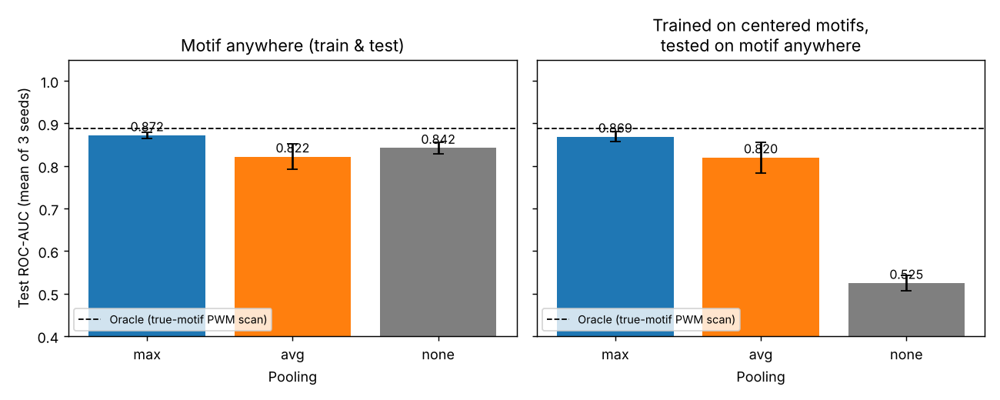
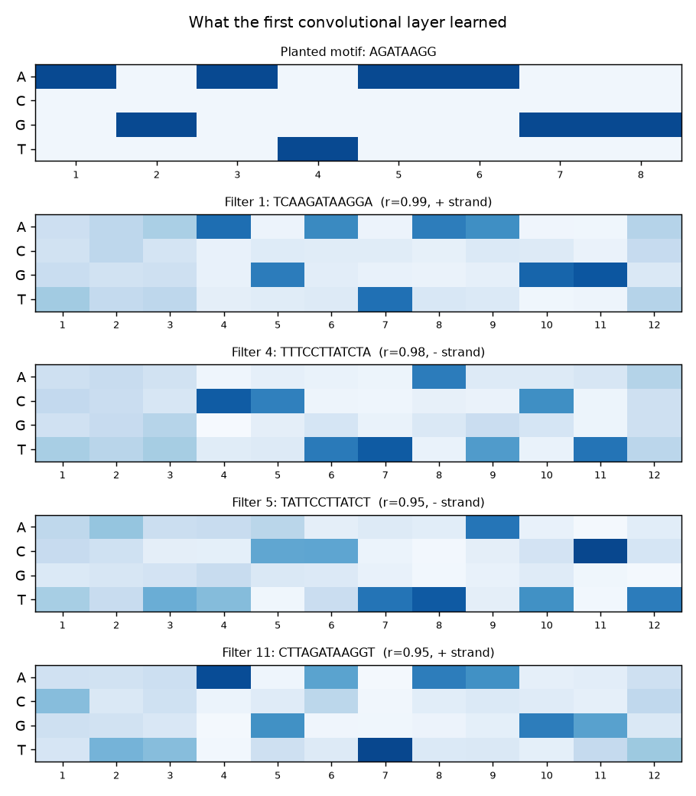

# DNA Motif Detection with a Convolutional Neural Network

A 1D CNN in PyTorch that predicts whether a DNA sequence contains a transcription-factor
binding site, plus an experiment showing **why max pooling matters** for genomic sequence models,
and an interpretation step that checks whether the network actually learned the biological motif.

**Stack:** Python · PyTorch · NumPy · Pandas · Matplotlib · pytest · GitHub Actions

## The problem

Transcription factors (TFs) are proteins that switch genes on and off by binding short DNA
patterns called **motifs** (here, the GATA-family site `AGATAAGG`). Predicting binding from
raw sequence is a core task in computational genomics (DeepBind, Basset, DeepSEA). Two things
make it hard: the motif can appear **anywhere** in the sequence and on **either strand**, and
real sites are **noisy** (not every base matches the consensus).

## How the model works

```
DNA sequence (200 bp)
   │  one-hot encode: A=[1,0,0,0], C=[0,1,0,0], G=[0,0,1,0], T=[0,0,0,1]  → (4 × 200)
   ▼
Conv1d (32 filters × 12 bp) + BatchNorm + ReLU   ← each filter is a learnable motif scanner (PWM)
   ▼
MaxPool1d (4)                                     ← keep the strongest match in each region
   ▼
Conv1d (32 × 5) + ReLU + Dropout                  ← combinations of motifs
   ▼
Global max pool                                   ← "is the motif present anywhere?"
   ▼
Linear → sigmoid → P(bound)
```

**Why max pooling?** A convolution filter outputs a match score at every position. Max pooling
keeps the best score and drops *where* it occurred. Biologically, a binding site counts whether
it sits at base 20 or base 180, so this built-in **translation invariance** is exactly the right
assumption. Average pooling dilutes one strong match across 200 positions of background, and
no pooling forces the classifier to learn a separate weight for every position.

## Data

A synthetic benchmark with known ground truth, in the style of the DeepBind simulation
experiments: 200 bp sequences at human-genome GC content (~42%); half contain one noisy copy
of the GATA motif (each base matches the consensus with p = 0.9) at a random position, on a
random strand. Knowing the true motif lets us (1) compute an **oracle baseline** and
(2) verify what the filters learned.

Real data works too: `python experiments/train_model.py --pos bound.fa --neg unbound.fa`
(for example, ChIP-seq peaks from ENCODE or the *Genomic Benchmarks* datasets).

## Results

All numbers are means over 3 random seeds on 2,000 held-out test sequences (`results/`).

### 1. Pooling ablation

| Pooling | Test ROC-AUC (motif anywhere) | Test ROC-AUC (trained on centered motifs only) | Parameters |
|---|---|---|---|
| **Max** | **0.872 ± 0.007** | **0.869 ± 0.011** | 6,817 |
| Average | 0.822 ± 0.030 | 0.820 ± 0.036 | 6,817 |
| None (flatten) | 0.842 ± 0.014 | 0.525 ± 0.018 | 12,833 |
| *Oracle (true-motif PWM scan)* | *0.888* | *0.888* | – |



- **Max pooling reached 98% of the oracle's AUC** while learning the motif from scratch, and beat average pooling and no pooling in every seed.
- **Position-shift test:** when trained only on motifs near the center and tested on motifs anywhere, the model without pooling **collapsed to chance (AUC 0.52)**. The max-pooling model was unaffected (0.869), which is direct evidence of translation invariance.
- The no-pooling model also needed almost **2× the parameters** for a worse result.

### 2. Did the network learn the biology?

Each first-layer filter was converted into a position weight matrix from its most strongly
activating test sequences. The top filter matches the planted GATA motif with **Pearson r = 0.99**,
and several filters learned the **reverse complement** (`CCTTATCT`) on their own, so the model
found binding sites on both DNA strands without being told about strands.




## Run it

```bash
pip install -r requirements.txt
python experiments/train_model.py        # train + evaluate + interpret filters (~1 min CPU)
python experiments/compare_pooling.py    # full pooling experiment, 3 seeds (~10-15 min CPU)
pytest -q tests                          # 12 tests
```

## Project structure

```
src/dnacnn/
  data.py        one-hot encoding, reverse complement, FASTA reader, synthetic dataset
  model.py       DNACNN with switchable pooling (max / avg / none)
  train.py       training loop, early stopping, ROC-AUC (implemented from scratch)
  baseline.py    oracle PWM-scan baseline
  interpret.py   filter → PWM extraction, information content, motif matching
experiments/
  train_model.py      single model run with interpretation
  compare_pooling.py  pooling ablation across seeds and a position-shift test
tests/                unit tests (encoding, shapes, shift invariance, AUC, baseline)
results/              generated charts, CSVs, and reports
```

## Limitations and next steps

- The benchmark is synthetic; the next step is real ChIP-seq data (e.g. ENCODE GATA1 peaks vs. shuffled or flanking controls).
- One motif per sequence; real regulatory regions combine several motifs (motif grammar).
- Possible extensions: reverse-complement weight sharing, attention layers, and attribution maps (saliency / integrated gradients).

## References

- Alipanahi et al. (2015). *Predicting the sequence specificities of DNA- and RNA-binding proteins by deep learning* (DeepBind). Nature Biotechnology.
- Kelley et al. (2016). *Basset: learning the regulatory code of the accessible genome with deep convolutional neural networks*. Genome Research.
- Koo & Eddy (2019). *Representation learning of genomic sequence motifs with convolutional neural networks*. PLOS Computational Biology.
